<div align="center">

# ⚔️ Belladorn

**쿼터뷰 RPG 액션 · 대학 캡스톤디자인 팀 프로젝트**

*과거의 영웅을 계승해 스킬을 강화하며 성장하는 **쿼터뷰 액션 RPG***

[](https://unity.com/)
[](#)
[](#)
[](#)

[▶ 플레이 영상 (YouTube)](https://www.youtube.com/watch?v=UThz7KhKTDc) · [🌐 포트폴리오 사이트](https://chlwnsdud2025.github.io/projects/belladorn.html)

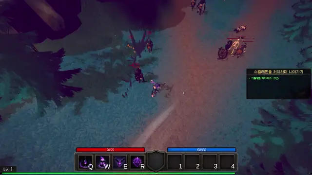 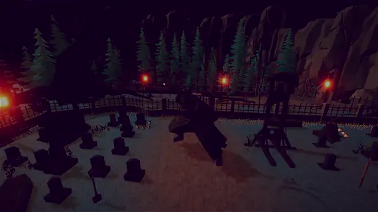

<sub>왼쪽: 마법사 직업의 QWER 스킬 전투 · 오른쪽: 챕터 1 보스전</sub>

</div>

<br>

## 📌 프로젝트 개요

| 항목 | 내용 |
| --- | --- |
| **장르** | 쿼터뷰 RPG 액션 |
| **개발 형태** | 팀 프로젝트 (3인) · 한림대학교 2025학년도 1학기 캡스톤디자인 |
| **개발 기간** | 2025.03.17 – 2025.05.27 |
| **플랫폼** | PC |
| **개발 환경** | Unity 2022.3 (2022.3.44f1), C#, URP, Input System, NavMesh |
| **맡은 역할** | **직업 · 스킬 · 전투 판정 · 플레이어 스탯 · 인벤토리 / 장비 · 퀘스트 · UI · 씬 흐름** |
| **작성 비중** | 직접 작성된 C# 약 9,800줄 중 약 5,700줄 (57%) <sub>· git blame 기준, 자동 생성 코드 제외</sub> |

<br>

## 🎮 게임 소개

> 봉인의 열쇠가 시간의 문을 열고, 한 생명을 대가로 과거의 영웅을 현재로 불러냅니다.
> 플레이어는 계승할 영웅(직업)을 골라 숲과 유적을 지나며 퀘스트를 수행하고, 챕터 1의 보스에 도전합니다.

**진행 흐름** — 메인 메뉴 → 튜토리얼 → 유물 컷신 → 영웅(직업) 선택 → 챕터 1 (NPC 퀘스트 → 보스전)

<br>

## 🙋 담당 구현 요약

| # | 구현 내용 | 핵심 키워드 |
| :-: | --- | --- |
| 1 | [직업 시스템](#1-직업-시스템) | JobType 하나로 모델 · 애니메이터 · 스킬 · 스탯 교체 · ScriptableObject 데이터 |
| 2 | [스킬 실행 & 히트박스 판정](#2-스킬-실행--히트박스-판정) | 애니메이션 이벤트 타이밍 · Shape / 다단 히트 / 투사체 히트박스 프리팹 |
| 3 | [스킬 강화 & QWER 장착](#3-스킬-강화--qwer-장착) | 포인트 레벨업 · 분기 강화 · 같은 계열 중복 장착 방지 |
| 4 | [인벤토리 · 장비 · 퀵슬롯](#4-인벤토리--장비--퀵슬롯) | 48칸 스택 · 직업 제한 장비 · StatModifier 단일 경로 · 드래그 앤 드롭 |
| 5 | [퀘스트 · 대화](#5-퀘스트--대화) | 조건 ScriptableObject 조합 · 이벤트 기반 진행 · 연계 퀘스트 |
| 6 | [씬 흐름 · 캐릭터 선택](#6-씬-흐름--캐릭터-선택) | 4개 씬 · 매니저 유지 · 직업 선택 화면 |

<p align="center">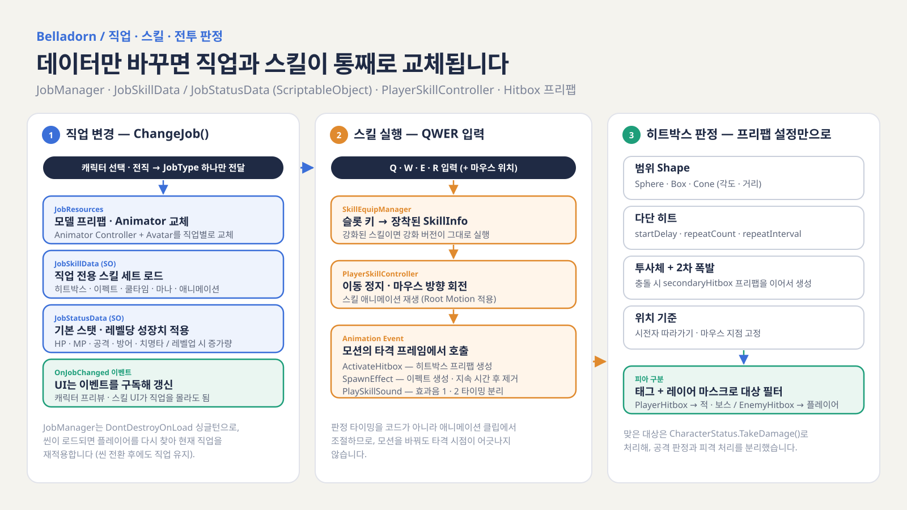</p>

---

## 1. 직업 시스템

> **직업 변경은 JobType 하나만 넘기면, 모델 · 애니메이터 · 스킬 세트 · 스탯이 데이터(ScriptableObject)로 한 번에 교체**

<p align="center">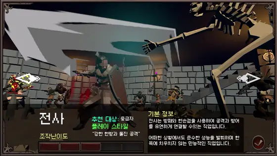</p>

| 설계 | 내용 |
| --- | --- |
| **데이터 분리** | 직업별 `JobResources`(모델 프리팹 · Animator Controller · Avatar), `JobSkillData`(스킬 세트), `JobStatusData`(기본 스탯 · 레벨당 성장치)로 나눠, 직업 추가는 데이터 추가로 처리 |
| **교체 순서** | 모델 교체 → Animator Controller · Avatar 교체 → 스킬 세트 로드 → 상태 머신 Idle → 직업 스탯 적용 → UI 갱신 |
| **이벤트 알림** | 교체가 끝나면 한 프레임 뒤 `OnJobChanged` 발행 → 캐릭터 프리뷰 · 스킬 UI가 새 모델 · 스킬 기준으로 갱신 |
| **씬 유지** | `DontDestroyOnLoad` 싱글턴으로 두고, 씬이 로드되면 플레이어를 다시 찾아 현재 직업을 재적용 |

```csharp
// JobManager.cs — 직업 하나로 모델 · 애니메이터 · 스킬 · 스탯을 함께 교체 (발췌 · 예외 처리 생략)
public void ChangeJob(JobType newJob)
{
    currentJob = newJob;
    var res = jobResourcesDict[newJob];

    if (currentModel != null) Destroy(currentModel);
    currentModel = Instantiate(res.modelPrefab, modelParent);            // 1. 모델

    playerAnimator.runtimeAnimatorController = res.animatorController;   // 2. 애니메이터
    playerAnimator.avatar = res.avatar;

    if (GetSkillData(newJob) is JobSkillData skillData)
        playerSkill.LoadSkillsFromData(skillData);                       // 3. 스킬 세트

    stateMachine.ChangeState(PlayerStateMachine.PlayerState.Idle);
    playerStatus.ApplyJobStats(GetStatData(newJob));                     // 4. 직업 스탯
    playerStatus.UpdateAllUI();

    StartCoroutine(InvokeJobChangedDelayed(newJob));                     // 5. 한 프레임 뒤 OnJobChanged
}
```

📂 **관련 코드** — [`JobManager.cs`](Assets/Scripts/Job/JobManager.cs) · [`JobStatusData.cs`](Assets/Scripts/Job/JobStatusData.cs) · [`SkillData.cs`](Assets/Scripts/Player/SkillData.cs) · [`PlayerStatus.cs`](Assets/Scripts/Player/PlayerStatus.cs)

---

## 2. 스킬 실행 & 히트박스 판정

> **판정 타이밍은 애니메이션 이벤트에, 판정 범위 · 횟수 · 형태는 히트박스 프리팹에 맡겨 스킬마다 판정 코드를 새로 짜지 않도록 구성**

<p align="center">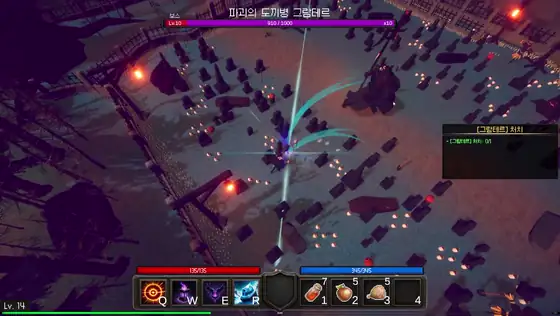</p>

| 설계 | 내용 |
| --- | --- |
| **입력 → 실행** | QWER 슬롯 키로 장착된 스킬을 조회 → 이동 정지 · 마우스 방향 회전 → 스킬 애니메이션 재생 (Root Motion) |
| **타이밍** | 모션의 타격 프레임에 넣은 Animation Event가 `ActivateHitbox` · `SpawnEffect` · `PlaySkillSound` 1 / 2를 호출 |
| **범위** | 히트박스 프리팹마다 Sphere · Box · Cone(각도 · 거리) 중 선택 |
| **다단 히트** | `startDelay` · `repeatCount` · `repeatInterval`만으로 단타 · 연타 구성 |
| **투사체** | 속도로 날아가다 충돌하면 2차 폭발 히트박스(`secondaryHitboxPrefab`)를 이어서 생성 |
| **위치 기준** | 시전자를 따라가는 판정 / 시전 순간의 마우스 지점에 고정되는 판정 |
| **피아 구분** | `PlayerHitbox` · `EnemyHitbox` 태그와 레이어 마스크로 대상을 거른 뒤 `CharacterStatus.TakeDamage()` 호출 — 공격 판정과 피격 처리를 분리 |

```csharp
// Hitbox.cs — 시작 지연 · 반복 횟수 · 간격만으로 단타 / 다단 히트를 구성 (발췌)
private IEnumerator HandleHitbox()
{
    yield return new WaitForSeconds(startDelay);

    for (int i = 0; i < repeatCount; i++)
    {
        ApplyDamage();                                    // Shape별 Overlap 판정 → TakeDamage
        yield return new WaitForSeconds(0.1f);

        if (i < repeatCount - 1)
            yield return new WaitForSeconds(repeatInterval);
    }

    yield return new WaitForSeconds(duration);
    Destroy(gameObject);
}
```

📂 **관련 코드** — [`PlayerSkillController.cs`](Assets/Scripts/Player/PlayerState/PlayerSkillController.cs) · [`HitBox.cs`](Assets/Scripts/GameSystem/HitBox.cs) · [`PlayerAttack.cs`](Assets/Scripts/Player/PlayerState/PlayerAttack.cs)

---

## 3. 스킬 강화 & QWER 장착

> **스킬 포인트로 레벨을 올리고, 원본에서 갈라지는 강화 스킬을 골라 QWER에 자유롭게 등록**

<p align="center">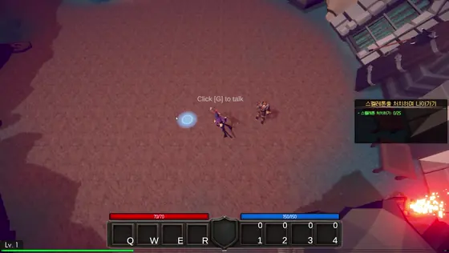</p>

| 설계 | 내용 |
| --- | --- |
| **스킬 포인트** | 레벨업 시 포인트 획득 (최대 8) · 레벨업 비용 = 다음 레벨 (Lv.1 → 2는 2포인트) · 레벨을 내리면 환불 · 최대 Lv.5 |
| **분기 강화** | 원본 스킬마다 `SkillUpgradeData`에 강화 옵션(최대 3개)을 두고, 강화 스킬은 `originalSkill`로 원본과 연결해 레벨을 함께 동기화 |
| **드래그 앤 드롭 장착** | 스킬 창에서 QWER 슬롯으로 끌어 등록 |
| **중복 장착 방지** | 원본과 그 강화 스킬은 같은 계열로 보고, 서로 다른 슬롯에 동시에 장착되지 않게 차단 |
| **강화 즉시 반영** | 이미 장착된 스킬을 강화하면 같은 슬롯에 강화 버전이 바로 들어감 |

```csharp
// SkillEquipManager.cs — 원본 스킬과 강화 스킬은 같은 계열로 보고 중복 장착을 막음
public void EquipSkill(string key, SkillInfo skill)
{
    foreach (var pair in equippedSkills)
    {
        if (pair.Key == key) continue;                    // 자기 슬롯은 제외
        bool isSameLine =
            pair.Value == skill ||
            pair.Value.originalSkill == skill ||
            skill.originalSkill == pair.Value;
        if (isSameLine) return;
    }
    equippedSkills[key] = skill;
    skill.skillKey = key;
}
```

📂 **관련 코드** — [`SkillEquipManager.cs`](Assets/Scripts/Player/PlayerUI/Skill_UI/SkillEquipManager.cs) · [`SkillSlotUI.cs`](Assets/Scripts/Player/PlayerUI/Skill_UI/SkillSlotUI.cs) · [`SkillUpgradeManager.cs`](Assets/Scripts/Player/PlayerUI/Skill_UI/SkillUpgradeManager.cs) · [`SkillUpgradeData.cs`](Assets/Scripts/Player/SkillUpgradeData.cs) · [`SkillPointManager.cs`](Assets/Scripts/Player/SkillPointManager.cs) · [`SkillUIManager.cs`](Assets/Scripts/Player/PlayerUI/Skill_UI/SkillUIManager.cs)

---

## 4. 인벤토리 · 장비 · 퀵슬롯

> **장비와 소비 아이템 버프가 같은 스탯 변경 경로(StatModifier)를 써서, 적용과 해제가 항상 대칭이 되도록 구성**

<table>
<tr>
<td width="50%">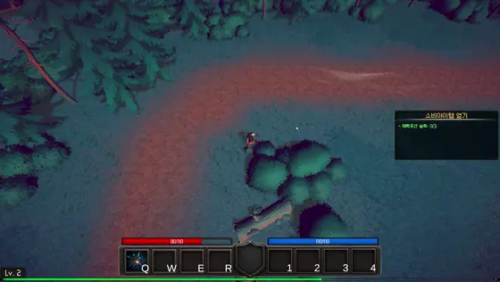</td>
<td width="50%">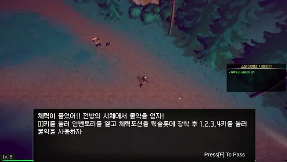</td>
</tr>
<tr>
<td align="center"><sub>장비 착용 → 체력 · 치명타 등 능력치 즉시 반영</sub></td>
<td align="center"><sub>인벤토리의 포션을 퀵슬롯으로 드래그해 등록</sub></td>
</tr>
</table>

| 설계 | 내용 |
| --- | --- |
| **아이템 데이터** | `ItemData`(SO)를 상속해 `EquipmentData`(7부위 · 착용 가능 직업 · StatModifier 목록), `ConsumableData`(체력 · 마나 회복 · 공격 / 방어 버프 · 지속 회복)로 확장 |
| **인벤토리** | 48칸 · 같은 아이템은 최대 스택까지 합치고 남은 수량은 빈 칸에 · 획득 시 퀘스트 `CollectItem` 조건 갱신 |
| **장비** | 착용 가능 직업 확인 → 같은 부위 기존 장비 해제 → StatModifier 적용 / 해제 시 같은 값을 음수로 되돌림 |
| **스탯 경로 통일** | 장비 · 소비 버프 모두 `StatusEffectApplier`로 스탯을 바꿔, 어디서 바꿨든 같은 방식으로 되돌릴 수 있음 |
| **퀵슬롯** | 1 ~ 4 키로 소비 아이템 사용 → 수량 차감 → 퀘스트 `UseItem` 조건 갱신 |
| **UI** | 인벤토리 ↔ 장비 ↔ 퀵슬롯 드래그 앤 드롭 · 툴팁 · 창 헤더 드래그 이동 · 현재 직업 모델을 비추는 캐릭터 프리뷰(RenderTexture) |

```csharp
// EquipmentManager.cs — 장착은 StatModifier 적용, 해제는 같은 값을 음수로 되돌림 (발췌)
public void EquipItem(EquipmentData equipment)
{
    if (!equipment.allowedJobs.Contains(JobManager.Instance.GetCurrentJob())) return;   // 직업 제한

    if (equippedItems.TryGetValue(equipment.equipmentType, out var oldEquip))
        UnequipItem(oldEquip);                                                          // 같은 부위 교체

    equippedItems[equipment.equipmentType] = equipment;
    var modifiers = equipment.GetAllStatModifiers();
    appliedModifiers[equipment.equipmentType] = new List<StatModifier>(modifiers);
    StatusEffectApplier.ApplyStatModifiers(playerStatus, modifiers);
}

public void UnequipItem(EquipmentData item)
{
    var negativeMods = new List<StatModifier>();
    foreach (var mod in appliedModifiers[item.equipmentType])
        negativeMods.Add(new StatModifier(mod.type, -mod.value, mod.isFlat));
    StatusEffectApplier.ApplyStatModifiers(playerStatus, negativeMods);
    // ...
}
```

📂 **관련 코드** — [`InventoryManager.cs`](Assets/Scripts/Player/PlayerUI/Inventory/InventoryManager.cs) · [`EquipmentManager.cs`](Assets/Scripts/Item/Item%20Data/EquipmentManager.cs) · [`StatusEffectApplier.cs`](Assets/Scripts/Job/StatusEffectApplier.cs) · [`ConsumableData.cs`](Assets/Scripts/Item/Item%20Data/ConsumableData.cs) · [`QuikSlotUI.cs`](Assets/Scripts/Player/PlayerUI/Inventory/QuikSlotUI.cs) · [`EquipmentSlotUI.cs`](Assets/Scripts/Item/EquipmentSlotUI.cs) · [`CharacterPreViewUI.cs`](Assets/Scripts/Player/PlayerUI/StateUI/CharacterPreViewUI.cs)

---

## 5. 퀘스트 · 대화

> **퀘스트는 조건 ScriptableObject를 조합한 에셋으로 만들고, 각 시스템은 "무슨 일이 일어났는지"만 알려 진행도를 올림**

<p align="center">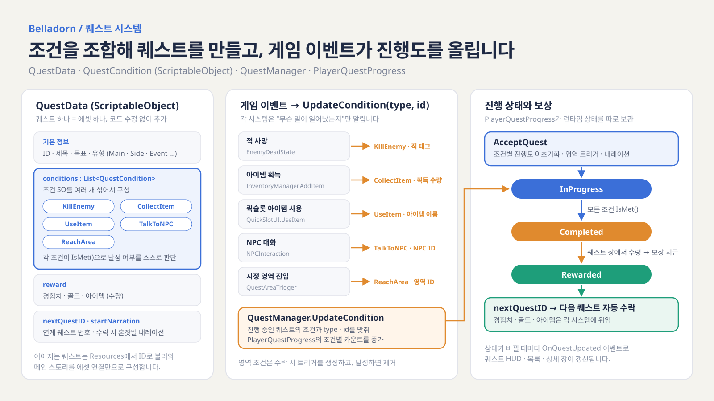</p>

<table>
<tr>
<td width="50%">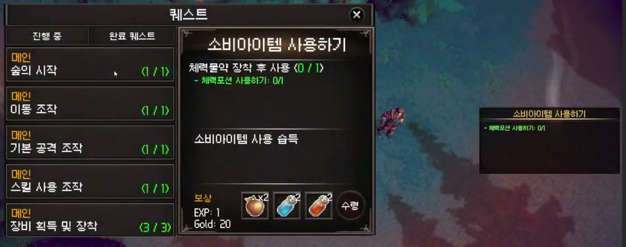</td>
<td width="50%">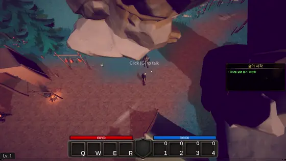</td>
</tr>
<tr>
<td align="center"><sub>퀘스트 창 — 진행 / 완료 목록 · 조건 진행도 · 보상 수령</sub></td>
<td align="center"><sub>NPC 대화로 퀘스트 수락 · 진행</sub></td>
</tr>
</table>

| 설계 | 내용 |
| --- | --- |
| **조건 조합** | 추상 `QuestCondition`(SO)을 상속한 `KillEnemy` · `CollectItem` · `UseItem` · `TalkToNPC` · `ReachArea` 조건을 퀘스트마다 섞어서 구성 · 각 조건이 `IsMet()`으로 달성 판단 |
| **이벤트 기반 진행** | 적 사망 · 아이템 획득 / 사용 · NPC 대화 · 영역 진입 시 `UpdateCondition(type, id)`만 호출 → 진행 중인 퀘스트의 맞는 조건만 갱신 |
| **상태 분리** | 퀘스트 정의(`QuestData`)와 런타임 진행(`PlayerQuestProgress`)을 분리 · InProgress → Completed → Rewarded |
| **연계 퀘스트** | 보상을 받으면 `nextQuestID`로 다음 퀘스트를 불러와 자동 수락 → 메인 스토리를 에셋 연결로 구성 |
| **영역 조건** | 수락 시 목표 지점에 트리거를 생성하고, 도달하면 제거 |
| **UI 갱신** | `OnQuestUpdated` 이벤트로 화면 우측 HUD · 퀘스트 목록 · 상세 창을 갱신 · NPC 대화와 수락 내레이션 출력 |

```csharp
// QuestManager.cs — 시스템은 type · id만 넘기고, 조건 매칭은 QuestManager가 담당 (발췌)
public void UpdateCondition(string type, string identifier, int amount = 1)
{
    foreach (var progress in activeQuests)
    {
        if (progress.state != QuestState.InProgress) continue;

        for (int i = 0; i < progress.questData.conditions.Count; i++)
        {
            var condition = progress.questData.conditions[i];
            if (condition is KillEnemyCondition killCond && type == "KillEnemy" && killCond.targetEnemyTag == identifier)
                progress.IncrementProgress(i, amount);
            else if (condition is ReachAreaCondition areaCond && type == "ReachArea" && areaCond.areaID == identifier)
            {
                progress.IncrementProgress(i, amount);
                QuestAreaTriggerSpawner.Instance?.RemoveTrigger(identifier);
            }
            // CollectItem · TalkToNPC · UseItem도 같은 방식
        }

        if (progress.IsAllConditionsMet() && progress.state != QuestState.Completed)
            progress.state = QuestState.Completed;

        OnQuestUpdated?.Invoke(progress);
    }
}
```

📂 **관련 코드** — [`QuestManager.cs`](Assets/Scripts/GameSystem/Quest/QuestManager.cs) · [`QuestData.cs`](Assets/Scripts/GameSystem/Quest/QuestData.cs) · [`QuestCondition.cs`](Assets/Scripts/GameSystem/Quest/QuestCondition.cs) · [`PlayerQuestProgress.cs`](Assets/Scripts/GameSystem/Quest/PlayerQuestProgress.cs) · [`NPCInteraction.cs`](Assets/Scripts/GameSystem/Quest/NPCInteraction.cs) · [`DialogueSystem.cs`](Assets/Scripts/GameSystem/Quest/DialogueSystem.cs) · [`Quest_UI/`](Assets/Scripts/GameSystem/Quest/Quest_UI)

---

## 6. 씬 흐름 · 캐릭터 선택

> **메인 메뉴 → 튜토리얼 → 캐릭터 선택 → 챕터 1로 이어지는 씬을 나누고, 씬이 바뀌어도 직업 · 진행 데이터가 끊기지 않도록 구성**

<p align="center">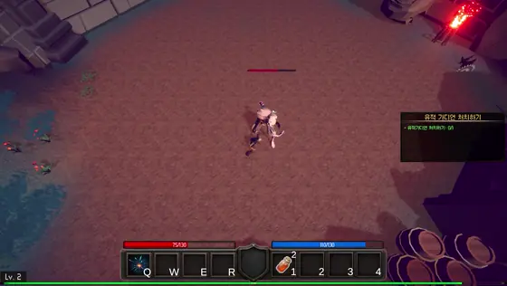</p>

| 설계 | 내용 |
| --- | --- |
| **컷신 전환** | 튜토리얼 마지막 퀘스트를 완료하고 유물과의 대화가 끝나면 화면을 페이드아웃하고 내레이션 텍스트를 순서대로 띄운 뒤, [G] 입력 시 캐릭터 선택 씬으로 이동 |
| **캐릭터 선택** | 직업마다 카메라 포인트로 이동하며 직업 설명 · 난이도(1 ~ 5) · 추천 대상 · 플레이 스타일 표시 → 확정 시 선택 직업을 `JobManager`에 저장하고 게임 씬 로드 |
| **데이터 유지** | 직업 정보를 가진 매니저를 씬 사이에서 유지하고, 새 씬이 로드되면 플레이어와 UI 참조를 다시 연결 |

📂 **관련 코드** — [`ScreenTransitionController.cs`](Assets/Scripts/GameSystem/ScreenTransitionController.cs) · [`CharacterSelectionUI.cs`](Assets/Scripts/GameSystem/CharacterSelectionUI.cs) · [`CharacterSelectCameraController.cs`](Assets/Scripts/GameSystem/CharacterSelectCameraController.cs)

---

## 🧰 기술 스택

| 분류 | 사용 기술 |
| --- | --- |
| **Engine** | Unity 2022.3 (2022.3.44f1), URP |
| **Language** | C# |
| **Data** | ScriptableObject (직업 · 스킬 · 강화 · 아이템 · 퀘스트 · 조건) |
| **Animation** | Animator, Animation Event, Root Motion |
| **UI** | uGUI, TextMeshPro, EventSystems 드래그 앤 드롭, RenderTexture 캐릭터 프리뷰 |
| **Input / AI** | Input System, NavMesh |
| **Collaboration** | Git, GitHub |

> 적 · 보스 AI와 공격 패턴, 이동 · 입력 · 카메라, 맵은 팀원이 담당했습니다.
> 공개본에서는 유료 에셋과 애니메이션 클립을 제외했습니다. `main`은 프로젝트 최종 브랜치(`function_B`) 기준입니다.

<br>

<div align="center">

**최준영 · Unity Client Developer**
📧 juny2221@gmail.com · ▶ [YouTube](https://www.youtube.com/channel/UCMoIuWbEUPRG-8-CIZpd6cQ)

</div>
