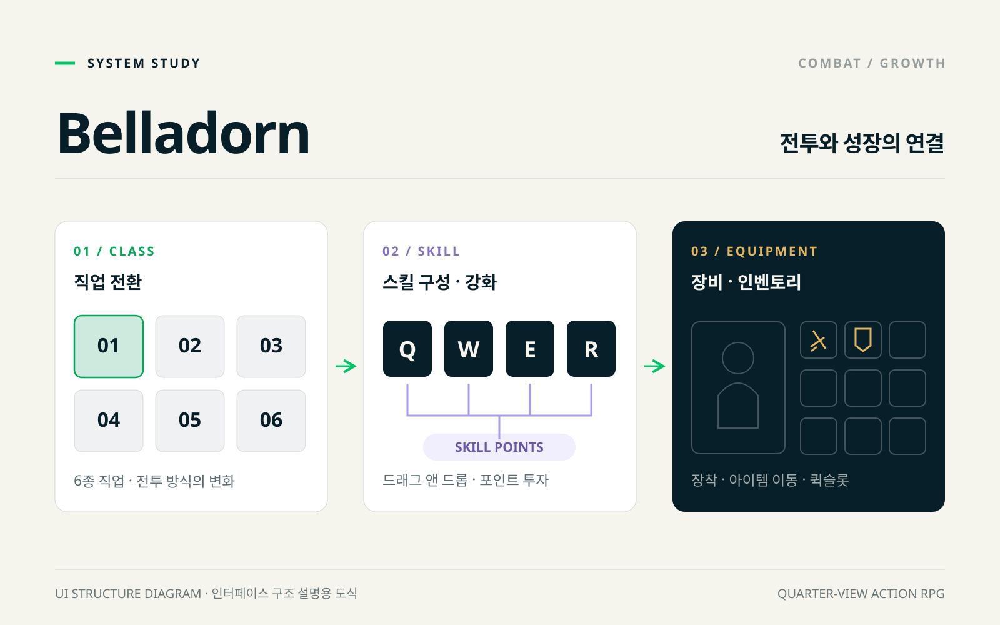
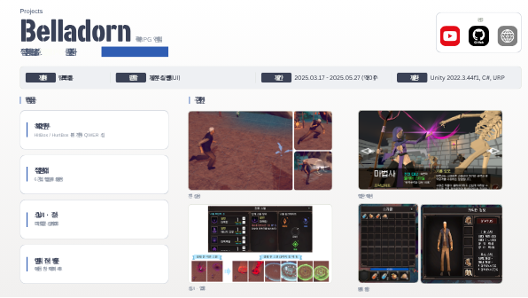

<div align="center">

# ⚔️ Belladorn

**쿼터뷰 RPG 액션 · 대학 캡스톤 팀 프로젝트**

*직업 전환과 스킬 강화로 성장하는, **전투에서 성장까지 이어지는 RPG***

[](https://unity.com/)
[](#)
[](#)

[🌐 포트폴리오 사이트](https://chlwnsdud2025.github.io/projects/belladorn.html) · [📑 원본 프로젝트 포트폴리오](https://www.canva.com/d/mzu8Fvwvj8IVG7d)



</div>

<br>

## 📌 프로젝트 개요

| 항목 | 내용 |
| --- | --- |
| **장르** | 쿼터뷰 RPG 액션 |
| **개발 형태** | 팀 프로젝트 (대학 캡스톤) |
| **개발 기간** | 2025.03.17 – 2025.05.27 |
| **플랫폼** | PC |
| **개발 환경** | Unity 2022.3 (2022.3.44f1), C#, URP, Input System |
| **맡은 역할** | **전투 · 스킬 · 인벤토리 · UI** |

<br>

## 🎮 게임 소개

> 직업 전환과 스킬 강화로 성장하는 액션 RPG입니다.
> 직업별 전투부터 인벤토리 · 장비 · 스킬 UI까지 플레이 흐름을 구현했습니다.

<br>

## 🙋 담당 구현 요약

| # | 구현 내용 | 핵심 키워드 |
| :-: | --- | --- |
| 1 | [HitBox와 HurtBox를 분리한 전투](#1-hitbox와-hurtbox를-분리한-전투) | 공격 판정 / 피격 처리 분리 · 기본 공격 · QWER 스킬 |
| 2 | [6종 직업과 전용 스킬 세트](#2-6종-직업과-전용-스킬-세트) | 직업 전환 · 전용 스킬 세트 · 상태이상 |
| 3 | [스킬 슬롯과 포인트 강화](#3-스킬-슬롯과-포인트-강화) | 드래그 앤 드롭 스킬 슬롯 · 스킬 포인트 업그레이드 |
| 4 | [인벤토리 · 장비 · 퀵슬롯](#4-인벤토리--장비--퀵슬롯) | 아이템 이동 · 장착 · 캐릭터 프리뷰 · 퀘스트 |

---

## 1. HitBox와 HurtBox를 분리한 전투

| 단계 | 내용 |
| --- | --- |
| **문제** | 다양한 기본 공격과 스킬에 공통 피해 처리가 필요했습니다. |
| **구현** | HitBox / HurtBox를 분리하고 기본 공격과 QWER 스킬을 구현했습니다. |
| **결과** | 공격 판정과 피격 처리를 분리한 전투 구조를 구성했습니다. |

```
HitBox  →  HurtBox  →  공통 피해 처리  →  공격 · 스킬
```

📂 **관련 코드** — [`HitBox.cs`](Assets/Scripts/GameSystem/HitBox.cs) · [`PlayerAttack.cs`](Assets/Scripts/Player/PlayerState/PlayerAttack.cs) · [`PlayerSkill.cs`](Assets/Scripts/Player/PlayerState/PlayerSkill.cs)

---

## 2. 6종 직업과 전용 스킬 세트

| 단계 | 내용 |
| --- | --- |
| **문제** | 직업을 전환할 때 행동과 스킬 구성이 함께 바뀌어야 했습니다. |
| **구현** | 6종 직업의 스킬 세트와 상태이상 적용을 구현했습니다. |
| **결과** | 직업에 따라 전투 구성이 바뀌는 성장 흐름을 구성했습니다. |

```
직업 선택  →  전용 스킬 세트  →  상태이상  →  전투 구성 변경
```

📂 **관련 코드** — [`JobManager.cs`](Assets/Scripts/Job/JobManager.cs) · [`JobStatusData.cs`](Assets/Scripts/Job/JobStatusData.cs) · [`StatusEffectApplier.cs`](Assets/Scripts/Job/StatusEffectApplier.cs)

---

## 3. 스킬 슬롯과 포인트 강화

| 단계 | 내용 |
| --- | --- |
| **문제** | 스킬 배치와 성장 선택을 UI로 제공해야 했습니다. |
| **구현** | 드래그 앤 드롭 스킬 슬롯과 스킬 포인트 업그레이드를 구현했습니다. |
| **결과** | 스킬 구성을 바꾸고 강화하는 사용자 흐름을 연결했습니다. |

```
드래그 앤 드롭  →  스킬 슬롯  →  스킬 포인트  →  스킬 강화
```

📂 **관련 코드** — [`SkillSlotDragHandler.cs`](Assets/Scripts/Player/PlayerUI/Skill_UI/SkillSlotDragHandler.cs) · [`SkillEquipManager.cs`](Assets/Scripts/Player/PlayerUI/Skill_UI/SkillEquipManager.cs) · [`SkillUpgradeManager.cs`](Assets/Scripts/Player/PlayerUI/Skill_UI/SkillUpgradeManager.cs) · [`SkillPointManager.cs`](Assets/Scripts/Player/SkillPointManager.cs)

---

## 4. 인벤토리 · 장비 · 퀵슬롯

| 단계 | 내용 |
| --- | --- |
| **문제** | 획득 · 장착 · 사용과 캐릭터 상태를 여러 UI가 공유해야 했습니다. |
| **구현** | 아이템 이동, 장착, 캐릭터 프리뷰와 퀘스트를 구현했습니다. |
| **결과** | 아이템 관리부터 장비 변경까지 RPG의 기본 UI를 구성했습니다. |

```
아이템 획득  →  인벤토리 이동  →  장비 · 퀵슬롯  →  캐릭터 프리뷰
```

📂 **관련 코드** — [`InventoryManager.cs`](Assets/Scripts/Player/PlayerUI/Inventory/InventoryManager.cs) · [`QuikSlotUI.cs`](Assets/Scripts/Player/PlayerUI/Inventory/QuikSlotUI.cs) · [`EquipmentManager.cs`](Assets/Scripts/Item/Item%20Data/EquipmentManager.cs) · [`EquipmentSlotUI.cs`](Assets/Scripts/Item/EquipmentSlotUI.cs) · [`CharacterPreViewUI.cs`](Assets/Scripts/Player/PlayerUI/StateUI/CharacterPreViewUI.cs) · [`QuestManager.cs`](Assets/Scripts/GameSystem/Quest/QuestManager.cs)

<details>
<summary>📑 원본 프로젝트 포트폴리오 보기</summary>
<br>
<a href="https://www.canva.com/d/mzu8Fvwvj8IVG7d"></a>
</details>

---

## 🧰 기술 스택

| 분류 | 사용 기술 |
| --- | --- |
| **Engine** | Unity 2022.3 (2022.3.44f1), URP |
| **Language** | C# |
| **Input / Camera** | Input System, Cinemachine |
| **UI** | uGUI, TextMeshPro |
| **Collaboration** | Git, GitHub |

> `main`은 프로젝트 최종 브랜치(`function_B`) 기준의 상태입니다.

<br>

<div align="center">

**최준영 · Unity Client Developer**
📧 juny2221@gmail.com · ▶ [YouTube](https://www.youtube.com/channel/UCMoIuWbEUPRG-8-CIZpd6cQ)

</div>
